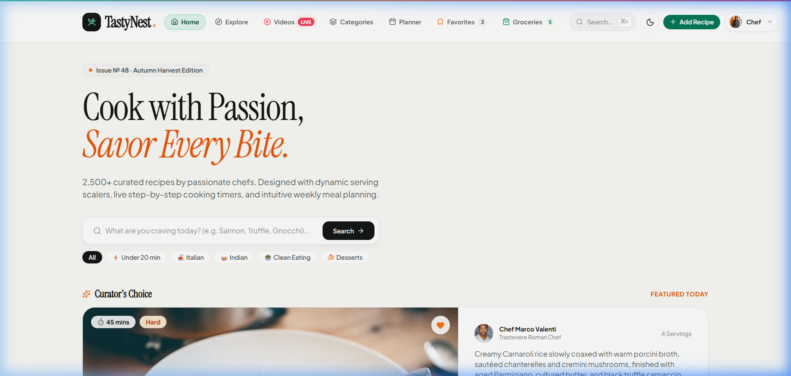

# 🍳 TastyNest — Gourmet Recipe Masterclass Studio

[](https://gourmet-recipe-masterclass.vercel.app/)
[](https://github.com/Arunsanap99/gourmet-recipe-masterclass)

[](#)
[](#)
[](#)
[](#)
[](#)
[](#license)

---

## 🔗 Live Demo

### 👉 **[https://gourmet-recipe-masterclass.vercel.app/](https://gourmet-recipe-masterclass.vercel.app/)**

> No login required — the entire culinary studio is open and free to explore instantly.

---

## 📸 Preview

<p align="center">
  
</p>

---

## 📖 About

**TastyNest** is a modern, responsive culinary web application featuring **20+ authentic chef-crafted recipes**, integrated **YouTube video masterclasses**, dynamic ingredient scaling, automated cooking timers, interactive weekly meal planning, and aisle-categorized grocery checklists — all wrapped in a premium, dark-mode-ready design.

---

## ✨ Key Features

### 🎬 Live YouTube Culinary Studio
- **Search any recipe** — type "Butter Chicken", "Potato Recipe", "Carbonara", or any dish name
- Real-time YouTube Data API v3 integration with **6 embeddable video results**
- Intelligent **fallback knowledge graph** with 60+ curated chef masterclass videos when API quota is exceeded
- Custom API key support for power users

### 🍽️ 20+ Chef-Crafted Recipes
- Butter Chicken, Authentic Carbonara, Szechuan Kung Pao, Wild Mushroom Risotto, Creamy Tuscan Salmon, Hyderabadi Dum Biryani, and many more
- Each recipe includes detailed ingredients, step-by-step instructions, chef's tips, and HD video masterclass

### ⚖️ Dynamic Servings Scaler
- Adjust portions from **1 to 20 servings** with real-time recalculation of all ingredient weights and measurements

### ⏱️ Live Cooking Timers
- Integrated countdown timers for every recipe step
- Sound/visual notifications with confetti celebrations on completion

### 📅 7-Day Interactive Meal Planner
- Schedule **Breakfast, Lunch, Dinner & Snacks** across all 7 days
- Live nutrition analytics, 1-click in-page dish picker
- Day shuffle, auto-balancing, and bulk generation

### 🛒 Smart Grocery Checklist
- Auto-generates shopping list from your weekly meal plan
- Grouped by supermarket aisles: `Produce`, `Dairy`, `Meat`, `Pantry`, `Spices`
- Export as formatted TXT file

### 👤 Chef Profile Studio
- Manage your culinary identity, dietary preferences, and avatar
- Export full JSON backups of all data

### 🎨 Premium Design
- Beautiful **dark & light modes** with smooth transitions
- Glassmorphism cards, micro-animations, and responsive layout
- Works on desktop, tablet, and mobile

### ☁️ Firebase Cloud Sync
- Real-time persistence with **Cloud Firestore**
- Favorites, meal plans, and shopping lists sync across devices

---

## 🛠️ Tech Stack

| Technology | Purpose |
|------------|---------|
| **HTML5** | Semantic structure & SEO |
| **Tailwind CSS** (CDN) | Utility-first styling with custom design tokens |
| **Vanilla JavaScript (ES6+)** | Single-page app routing, state management, rendering |
| **YouTube Data API v3** | Live recipe video search |
| **Firebase** (Auth + Firestore) | Cloud sync & data persistence |
| **Lucide Icons** | Premium SVG icon library |
| **Canvas Confetti** | Celebration animations |

---

## 📁 Project Structure

```
gourmet-recipe-masterclass/
├── index.html            # Main SPA shell with navigation, modals & dock
├── app.js                # Core application logic (routing, views, state)
├── recipes-data.js       # 20+ curated recipe dataset with full metadata
├── firebase-service.js   # Firebase Auth & Firestore cloud sync service
├── style.css             # Custom styles, animations & design tokens
├── favicon.svg           # App icon
├── .gitignore            # Git ignore rules
└── README.md             # This file
```

---

## 🚀 Quick Start

### Run Locally

No build step required — it's a pure static site:

```bash
# Clone the repo
git clone https://github.com/Arunsanap99/gourmet-recipe-masterclass.git
cd gourmet-recipe-masterclass

# Start any static server
python -m http.server 3000
# or
npx serve .
```

Open **http://localhost:3000** in your browser.

### Deploy to Vercel (1-Click)

1. Fork or push this repo to your GitHub
2. Connect it at [vercel.com](https://vercel.com)
3. Deploy with zero configuration — it's live instantly!

### Deploy to GitHub Pages

1. Go to **Settings** → **Pages**
2. Select `main` branch, `/ (root)` folder
3. Click **Save** — your site will be live at `https://<username>.github.io/gourmet-recipe-masterclass/`

---

## 🎯 App Sections

| Section | Route | Description |
|---------|-------|-------------|
| **Home** | `#home` | Hero banner, featured recipes, quick stats |
| **Explore** | `#explore` | Browse all 20+ recipes with category filters |
| **Video Studio** | `#videos` | Live YouTube search for any recipe video |
| **Categories** | `#categories` | Browse by cuisine (Indian, Italian, Asian, etc.) |
| **Meal Planner** | `#planner` | 7-day drag-and-drop meal scheduling |
| **Favorites** | `#favorites` | Your saved recipe collection |
| **Grocery List** | `#shopping` | Auto-generated aisle-sorted shopping list |
| **Publish Recipe** | `#add-recipe` | Submit your own recipe to the studio |
| **Profile** | `#profile` | Chef identity, preferences & data export |
| **Admin Studio** | `#admin` | Master Chef admin dashboard |

---

## 🔑 YouTube API Configuration

The app uses YouTube Data API v3 for live video search. A default studio key is included for demo purposes.

**To use your own API key:**
1. Go to [Google Cloud Console](https://console.cloud.google.com/)
2. Create a project and enable **YouTube Data API v3**
3. Generate an API key
4. Click the **⚙️ Custom API Key** button in the Video Studio section
5. Paste your key — searches will now use your quota

> **Note:** The free tier allows ~100 searches/day. When the quota is exceeded, the app seamlessly falls back to its curated knowledge graph of 60+ chef masterclass videos.

---

## 📄 License

MIT License — Feel free to customize and build your own culinary portfolio!

---

<p align="center">
  <strong>Built with ❤️ for food lovers everywhere</strong><br/>
  <a href="https://gourmet-recipe-masterclass.vercel.app/">🔗 Live Demo</a> · 
  <a href="https://github.com/Arunsanap99/gourmet-recipe-masterclass">📦 GitHub Repo</a>
</p>
